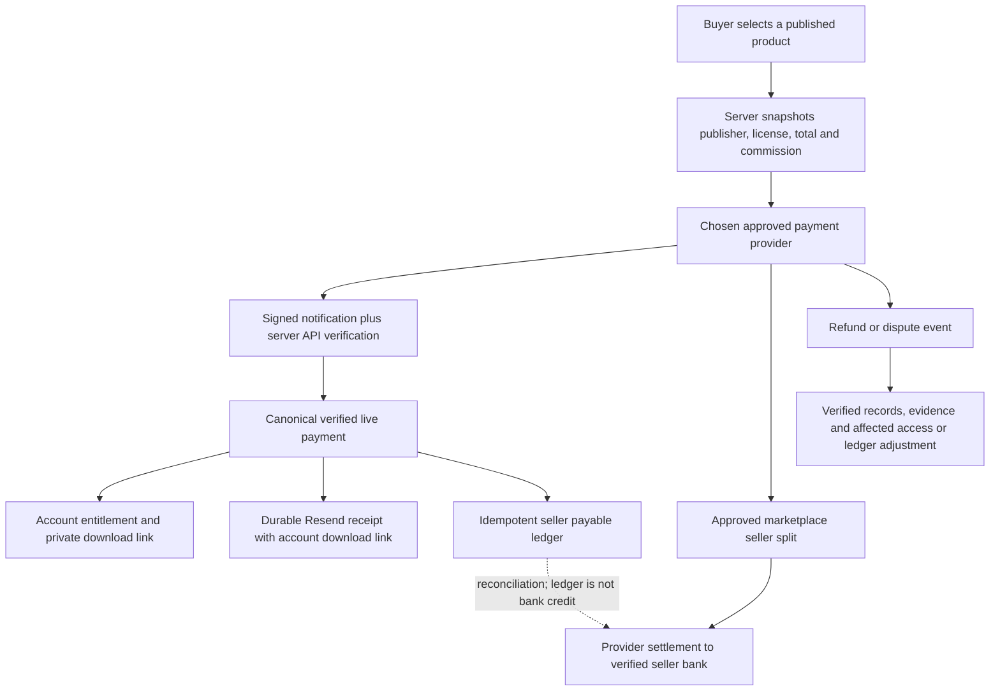

# Marketplace release validation — 24 October 2026

- TypeScript typecheck passed.
- Automated suite: **177 passed, 0 failed, 0 skipped**.
- Production build and native Vercel API runtime check passed.
- Fresh browser smoke: 10 public/auth/policy routes at 1440px and 390px; all nine Marketplace admin sections rendered. No JavaScript page errors or horizontal overflow.
- Mobile creator workflow: draft creation → private ZIP upload → review submission passed with synthetic responses; private KYC form fits the mobile viewport.

Financial tests cover canonical provider references/amount/currency/environment, test/live isolation, replay/concurrency, historical callbacks after disabling new checkout, partial refunds, dispute deadlines/discovery/ownership, immutable vendor agreement receipts, public seller disclosures, subscription consent/quote changes/paid periods/cancellation, private downloads and durable email retries. The native runtime check exercises missing configuration, API errors, HTML/SEO status and raw webhook bytes.

These are source, local database and synthetic provider/browser validations. **No real merchant transaction, account signup, provider onboarding, payment email or bank settlement was performed.** Live Supabase, private product ZIPs, Resend, deployment domain, scheduled jobs and provider marketplace/recurring activation must be configured and validated using the deployment guide. Registration continues its existing email/password flow; purchase, vendor and subscription agreements have separate affirmative acceptance records.

## Marketplace money flow

Company-owned Booyahstudio products use ordinary merchant checkout and do not create a third-party seller split. Creator paid platform plans and customer memberships have their own accepted offer and paid-period entitlement; a mandate alone does not unlock access. Existing payments, refunds and subscription mandates remain with their original provider after an admin gateway switch.
